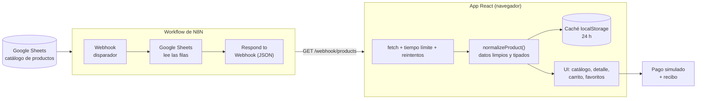

<div align="center">

[English](README.md) · **Español**

# Cartwell

### Shop well. Live well.

Una tienda en línea inmersiva en modo oscuro, creada con **React 19**, **TypeScript** y **Tailwind CSS**,
con un catálogo de productos servido desde un **workflow de N8N**.

**[Visita la tienda en vivo →](https://nrqrmz.github.io/ecommerce-n8n/)**

          

`Proyecto de portafolio` · `Mobile-first` · `Pagos simulados`

</div>

---

## Tabla de contenidos

- [Descripción general](#descripción-general)
- [Funcionalidades](#funcionalidades)
- [Tecnologías](#tecnologías)
- [Arquitectura y flujo de datos](#arquitectura-y-flujo-de-datos)
- [Primeros pasos](#primeros-pasos)
- [Estructura del proyecto](#estructura-del-proyecto)
- [Aspectos técnicos destacados](#aspectos-técnicos-destacados)
- [Despliegue](#despliegue)
- [Pruebas](#pruebas)
- [Hoja de ruta](#hoja-de-ruta)
- [Créditos](#créditos)
- [Autor y licencia](#autor-y-licencia)

## Descripción general

**Cartwell** es una tienda completamente funcional: explora cerca de 190 productos, filtra y busca en el
catálogo, abre un producto, agrégalo al carrito y finaliza la compra. Los pagos son **simulados**, por lo que
nunca se cobra nada.

La creé como proyecto de portafolio para mostrar cómo abordo un producto front-end completo: una identidad
visual distintiva, animaciones cuidadas, carga de datos resiliente y un diseño mobile-first, sin servidor
propio. La «base de datos» es una hoja de Google Sheets expuesta a la aplicación mediante un **workflow de N8N**
y un webhook.

> **Nota:** Es una demo. El catálogo son datos de ejemplo y no se procesan pedidos reales.

## Funcionalidades

### Compras

- **Catálogo** con búsqueda por texto, chips de categoría, orden (precio, nombre) y paginación. Los filtros
  viven en la URL, así que cada vista se puede compartir y el botón Atrás funciona.
- **Detalle de producto** con galería de imágenes, zoom a pantalla completa, especificaciones, ruta de
  navegación y productos relacionados.
- **Carrito lateral** que se abre como panel inferior en el teléfono y como panel lateral en escritorio, además
  de una página de carrito completa.
- **Favoritos** guardados en el navegador, con su propia página.
- **Pago simulado** que termina con una confirmación del pedido y un recibo estilo ticket.

### Experiencia

- La imagen del producto **vuela hacia el ícono del carrito** al agregarlo, y el contador del carrito se anima.
- **Confeti**, un check animado y un recibo que se «imprime» después del pago.
- Brillo que sigue al cursor e **inclinación 3D** en las tarjetas de producto (escritorio), aparición al hacer
  scroll y transiciones entre páginas.
- Diseño oscuro inmersivo: superficies de vidrio, fondo de aurora en movimiento y tipografía con degradado.
- Diseño **mobile-first** con áreas táctiles de 44 px y soporte para `prefers-reduced-motion`.

### Resiliencia

- Los productos se **guardan en el navegador durante 24 horas** y se actualizan en segundo plano.
- Las peticiones de red usan tiempo límite y reintentos automáticos; si fallan, se muestra un estado amigable
  para reintentar.
- El carrito persiste al recargar y se sincroniza entre pestañas.
- Un **error boundary** convierte los errores inesperados en una pantalla amigable y recuperable.

## Tecnologías

| Área | Tecnología | Para qué se usa |
| --- | --- | --- |
| Framework |  React 19 | Interfaz, hooks y contexto para el estado |
| Lenguaje |  TypeScript 6 | Código con tipos en toda la aplicación |
| Herramienta de build |  Vite 8 | Servidor de desarrollo y paquetes de producción |
| Estilos |  Tailwind CSS 4 | Estilos utility-first, mobile-first y tokens de diseño |
| Componentes de UI |  shadcn/ui ·  Radix UI | Primitivas accesibles (diálogos, paneles) escritas al estilo shadcn/ui |
| Animación |  Motion 14 | Resortes, animaciones de layout, transiciones de ruta y el vuelo al carrito |
| Celebración | `canvas-confetti` | Ráfaga de confeti al pagar |
| Notificaciones | `Sonner` | Avisos «Added to cart» |
| Íconos |  Lucide | Set de íconos |
| Navegación |  React Router 7 | `BrowserRouter` con enlaces directos |
| Tipografía |  Sora + Inter | Sora para títulos, Inter para el texto |
| Flujo de datos |  N8N ·  Google Sheets | Workflow con webhook que sirve el catálogo como JSON |
| Datos de ejemplo | **DummyJSON** | Catálogo de productos e imágenes |
| Linter | `oxlint` | Análisis de código rápido |
| Pruebas | `Playwright` | Flujos end-to-end manuales en un teléfono Android emulado |
| CI y hosting |  GitHub Actions ·  GitHub Pages | Build y despliegue en cada push a `master` |

## Arquitectura y flujo de datos

La aplicación **no tiene backend propio**. El catálogo vive en una hoja de Google Sheets y un workflow de N8N
lo expone como un endpoint JSON que la aplicación React consulta desde el navegador.



1. El catálogo (basado en datos de ejemplo de [DummyJSON](https://dummyjson.com)) se guarda en una hoja de
   Google Sheets.
2. Un **workflow de N8N** recibe la petición en un nodo **Webhook**, lee las filas con el nodo **Google Sheets**
   y las devuelve como JSON con un nodo **Respond to Webhook**.
3. La aplicación React consulta el JSON una vez, lo pasa por una **capa de normalización**
   (`src/lib/products.ts`) para que cada componente reciba productos limpios y tipados, y lo guarda en
   `localStorage` durante 24 horas.
4. El carrito, los favoritos y el último pedido viven en el navegador. El pago es simulado.

> El nodo Webhook debe permitir el origen del sitio (CORS) para que el navegador pueda leer la respuesta. La URL
> del endpoint se configura con la variable de entorno `VITE_N8N_PRODUCTS_URL`.

## Primeros pasos

**Requisitos:** Node.js 22 o superior.

```bash
# 1. Clona el repositorio
git clone https://github.com/nrqrmz/ecommerce-n8n.git
cd ecommerce-n8n

# 2. Instala las dependencias
npm install

# 3. Apunta la app a tu endpoint de productos (un webhook de N8N que devuelva un arreglo JSON)
echo "VITE_N8N_PRODUCTS_URL=https://tu-host-n8n/webhook/products" > .env.local

# 4. Inicia el servidor de desarrollo
npm run dev
```

Cada fila de producto debe verse así (los campos extra, como `row_number`, se ignoran):

```json
{
  "id": 1,
  "title": "Essence Mascara Lash Princess",
  "description": "A popular mascara known for its volumizing and lengthening effects.",
  "category": "beauty",
  "price": 9.99,
  "brand": "Essence",
  "sku": "BEA-ESS-ESS-001",
  "width": 15.14,
  "height": 13.08,
  "depth": 22.99,
  "image_url": "https://cdn.dummyjson.com/product-images/beauty/essence-mascara-lash-princess/1.webp",
  "thumbnail": "https://cdn.dummyjson.com/product-images/beauty/essence-mascara-lash-princess/thumbnail.webp"
}
```

### Scripts

| Comando | Descripción |
| --- | --- |
| `npm run dev` | Inicia el servidor de desarrollo de Vite |
| `npm run build` | Revisa los tipos y genera el build de producción |
| `npm run preview` | Previsualiza el build de producción en local |
| `npm run lint` | Analiza el código con oxlint |

## Estructura del proyecto

```text
src/
├── pages/              Pantallas: inicio, catálogo, producto, carrito, favoritos, confirmación de pedido
├── components/
│   ├── ui/             Primitivas al estilo shadcn/ui (sheet, dialog, toaster, ...)
│   ├── shop/           Componentes de la tienda: header, tarjeta de producto, filtros, carrito lateral, hero, ...
│   └── fx/             Efectos visuales: fondo de aurora, tarjeta interactiva, aparición al hacer scroll
├── context/            Estado: productos, carrito, favoritos, vuelo al carrito
├── hooks/              Hooks reutilizables: agregar al carrito, pago, media query
└── lib/                Normalización de productos, caché, constantes de marca, utilidades
scripts/                Prueba end-to-end manual (servidor N8N simulado + flujo de Playwright)
```

## Aspectos técnicos destacados

- **Datos en los que se puede confiar.** Una sola capa de normalización convierte filas irregulares de la hoja
  de cálculo (celdas vacías, números guardados como texto, campos nulos) en un tipo `Product` estricto, para que
  la interfaz nunca tenga que defenderse.
- **Carga rápida y resiliente.** La caché stale-while-revalidate con tiempo límite y reintentos mantiene la
  tienda instantánea en visitas posteriores y usable cuando el webhook es lento o no responde.
- **Robustez entre navegadores.** Los efectos respetan estrictamente el contrato de limpieza de React, así que
  la navegación se mantiene fluida incluso en navegadores nuevos cuyas APIs de scroll devuelven Promesas. El
  comportamiento está cubierto por el script end-to-end.
- **Accesible desde el diseño.** Controles con etiquetas, estados `aria-pressed`, áreas táctiles de 44 px,
  anillos de foco visibles y soporte de movimiento reducido.
- **Animación con propósito.** Las animaciones explican lo que ocurrió (el producto vuela al carrito, el recibo
  se imprime) y se desactivan para quienes prefieren menos movimiento.
- **Fotos sobre un «estudio» iluminado.** Las imágenes originales tienen fondo blanco, así que se mezclan sobre
  una superficie clara y suave para verse naturales en el tema oscuro.

## Despliegue

Cada push a `master` ejecuta un [workflow de GitHub Actions](.github/workflows/deploy.yml) que compila la
aplicación y la publica en **GitHub Pages**.

- La ruta base se inyecta al compilar (`VITE_BASE`), por lo que la app funciona bajo `/<repositorio>/`.
- `index.html` se copia a `404.html`, así los enlaces directos y las recargas siguen funcionando con
  `BrowserRouter`.
- El proyecto también está listo para **Vercel** (`vercel.json`) y **Netlify** (`public/_redirects`) sin cambios.

## Pruebas

Hay una prueba end-to-end manual en [`scripts/`](scripts/README.md). Levanta un servidor N8N simulado y recorre
la tienda con Playwright en un teléfono Android emulado: inicio, categorías, favoritos, zoom de producto, vuelo
al carrito, carrito lateral, pago, recibo y persistencia al recargar. También cubre datos irregulares,
almacenamiento del navegador no disponible, movimiento reducido y el comportamiento de scroll de navegadores
nuevos.

## Hoja de ruta

Ideas para futuras iteraciones (aún no construidas):

- Pagos reales con un proveedor de pagos
- Cuentas de usuario e historial de pedidos
- Sugerencias de búsqueda y un buscador estilo comando
- Pruebas automatizadas en CI

## Créditos

- **[DummyJSON](https://dummyjson.com)** por los datos de ejemplo de productos y sus imágenes.
- **[N8N](https://n8n.io)** por la automatización de workflows que sirve el catálogo.
- **[shadcn/ui](https://ui.shadcn.com)** y **[Radix UI](https://www.radix-ui.com)** por los patrones de
  componentes y las primitivas accesibles.
- **[Motion](https://motion.dev)** para la animación, **[Sonner](https://sonner.emilkowal.ski)** para los avisos
  y **[canvas-confetti](https://github.com/catdad/canvas-confetti)** para el efecto de celebración.
- **[Lucide](https://lucide.dev)** por los íconos y **[Google Fonts](https://fonts.google.com)** por Sora e Inter.
- **[Simple Icons](https://simpleicons.org)** (CC0) por los logotipos de tecnologías de este archivo, guardados
  en `docs/icons/`.
- Diseñado y desarrollado con **[Claude Code](https://claude.com/claude-code)** como asistente de programación
  con IA.

## Autor y licencia

Creado por **[@nrqrmz](https://github.com/nrqrmz)**.

Este es un proyecto de portafolio personal. Todos los derechos reservados: el código se publica para su revisión
y evaluación, y no se concede licencia para su reutilización. Los datos e imágenes de productos pertenecen a sus
respectivas fuentes (consulta los [Créditos](#créditos)).
