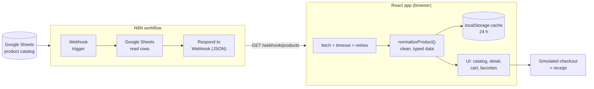

<div align="center">

# Cartwell

### Shop well. Live well.

An immersive dark e-commerce storefront built with **React 19**, **TypeScript** and **Tailwind CSS**,
powered by a product catalog served from an **N8N workflow**.

[](https://nrqrmz.github.io/ecommerce-n8n/)


`Portfolio project` · `Mobile-first` · `Simulated payments`

</div>

---

## Table of contents

- [Overview](#overview)
- [Features](#features)
- [Tech stack](#tech-stack)
- [Architecture and data flow](#architecture-and-data-flow)
- [Getting started](#getting-started)
- [Project structure](#project-structure)
- [Engineering highlights](#engineering-highlights)
- [Deployment](#deployment)
- [Testing](#testing)
- [Roadmap](#roadmap)
- [Credits](#credits)
- [Author and license](#author-and-license)

## Overview

**Cartwell** is a fully working storefront: browse about 190 products, filter and search the catalog, open a
product, add it to a cart, and check out. Payments are **simulated**, so nothing is ever charged.

I built it as a portfolio piece to show how I approach a complete front-end product: a distinctive visual
identity, polished motion, resilient data loading and a mobile-first layout, with no custom server. The
"database" is a Google Sheet exposed to the app through an **N8N workflow** and a webhook.

> **Note:** This is a demo. The catalog is sample data and no real orders are processed.

## Features

### Shopping

- **Catalog** with text search, category chips, sorting (price, name) and pagination. Filters live in the URL,
  so every view is shareable and the Back button works.
- **Product detail** with image gallery, full-screen zoom, specs, breadcrumb and related products.
- **Cart drawer** that opens as a bottom sheet on phones and a side panel on desktop, plus a full cart page.
- **Favorites** saved in the browser, with their own page.
- **Simulated checkout** that ends with an order confirmation and a printed-style receipt.

### Experience

- The product image **flies into the cart icon** when you add it, and the cart badge animates.
- **Confetti**, an animated check and a receipt that "prints" after payment.
- Pointer-following glow and **3D tilt** on product cards (desktop), scroll reveals and route transitions.
- Immersive dark design: glass surfaces, drifting aurora background, gradient typography.
- **Mobile-first** layout with 44 px touch targets, plus support for `prefers-reduced-motion`.

### Resilience

- Products are **cached in the browser for 24 hours** and refreshed in the background.
- Network requests use a timeout and automatic retries; failures show a friendly retry state.
- The cart persists across reloads and syncs between tabs.
- An **error boundary** turns unexpected crashes into a recoverable screen instead of a blank page.

## Tech stack

| Area | Technology | Used for |
| --- | --- | --- |
| Framework |  | UI, hooks and context for state |
| Language |  | Type-safe code across the app |
| Build tool |  | Dev server and production bundles |
| Styling |  | Utility-first, mobile-first styling and design tokens |
| UI components |   | Accessible primitives (dialogs, sheets) written in the shadcn/ui style |
| Animation |  | Springs, layout animations, route transitions, fly-to-cart |
| Celebration | `canvas-confetti` | Confetti burst on payment |
| Notifications | `Sonner` | "Added to cart" toasts |
| Icons |  | Icon set |
| Routing |  | `BrowserRouter` with deep links |
| Typography |  | Sora for headings, Inter for text |
| Data pipeline |   | Webhook workflow that serves the catalog as JSON |
| Sample data | **DummyJSON** | Product catalog and product images |
| Linting | `oxlint` | Fast linting |
| Testing | `Playwright` | Manual end-to-end flows on an emulated Android phone |
| CI and hosting |   | Build and deploy on every push to `master` |

## Architecture and data flow

The app has **no custom backend**. The product catalog lives in a Google Sheet, and an N8N workflow exposes it
as a JSON endpoint that the React app calls from the browser.



1. The catalog (based on [DummyJSON](https://dummyjson.com) sample data) is stored in a Google Sheet.
2. An **N8N workflow** receives a request on a **Webhook** node, reads the rows with the **Google Sheets** node
   and returns them as JSON with a **Respond to Webhook** node.
3. The React app fetches the JSON once, runs it through a **normalization layer**
   (`src/lib/products.ts`) so every component receives clean, typed products, and caches it in
   `localStorage` for 24 hours.
4. The cart, favorites and the last order live in the browser. Checkout is simulated.

> The Webhook node must allow the site's origin (CORS) so the browser can read the response. The endpoint URL
> is configured with the `VITE_N8N_PRODUCTS_URL` environment variable.

## Getting started

**Requirements:** Node.js 22 or newer.

```bash
# 1. Clone the repository
git clone https://github.com/nrqrmz/ecommerce-n8n.git
cd ecommerce-n8n

# 2. Install dependencies
npm install

# 3. Point the app at your product endpoint (an N8N webhook returning a JSON array)
echo "VITE_N8N_PRODUCTS_URL=https://your-n8n-host/webhook/products" > .env.local

# 4. Start the dev server
npm run dev
```

Each product row is expected to look like this (extra fields such as `row_number` are ignored):

```json
{
  "id": 1,
  "title": "Essence Mascara Lash Princess",
  "description": "A popular mascara known for its volumizing and lengthening effects.",
  "category": "beauty",
  "price": 9.99,
  "brand": "Essence",
  "sku": "BEA-ESS-ESS-001",
  "width": 15.14,
  "height": 13.08,
  "depth": 22.99,
  "image_url": "https://cdn.dummyjson.com/product-images/beauty/essence-mascara-lash-princess/1.webp",
  "thumbnail": "https://cdn.dummyjson.com/product-images/beauty/essence-mascara-lash-princess/thumbnail.webp"
}
```

### Scripts

| Command | Description |
| --- | --- |
| `npm run dev` | Start the Vite dev server |
| `npm run build` | Type-check and build for production |
| `npm run preview` | Preview the production build locally |
| `npm run lint` | Lint the code with oxlint |

## Project structure

```text
src/
├── pages/              Route screens: home, catalog, product, cart, favorites, order confirmation
├── components/
│   ├── ui/             shadcn/ui-style primitives (sheet, dialog, toaster, ...)
│   ├── shop/           Store components: header, product card, filters, cart drawer, hero, ...
│   └── fx/             Visual effects: aurora background, interactive card, scroll reveal
├── context/            State: products, cart, favorites, fly-to-cart
├── hooks/              Reusable hooks: add to cart, checkout, media query
└── lib/                Product normalization, cache, brand constants, helpers
scripts/                Manual end-to-end check (mock N8N server + Playwright flow)
```

## Engineering highlights

- **Data you can trust.** A single normalization layer converts messy spreadsheet rows (blank cells, numbers
  stored as text, null fields) into a strict `Product` type, so the UI never has to defend itself.
- **Fast, resilient loading.** Stale-while-revalidate caching with a timeout and retries keeps the store
  instant on return visits and usable when the webhook is slow or down.
- **Bug found on a real device, fixed with a regression test.** A newer Android Chrome returns a Promise from
  `window.scrollTo`; returning it from an effect crashed navigation. The fix and a reproduction mode now live in
  the end-to-end script.
- **Accessible by default.** Labeled controls, `aria-pressed` states, 44 px touch targets, visible focus rings
  and reduced-motion support.
- **Motion with purpose.** Animations explain what happened (the item flies to the cart, the receipt prints) and
  are switched off for users who prefer less motion.
- **Photos on a lit "studio" tile.** Source images have white backgrounds, so they are blended onto a soft light
  surface to look natural on the dark theme.

## Deployment

Every push to `master` triggers a [GitHub Actions workflow](.github/workflows/deploy.yml) that builds the app
and publishes it to **GitHub Pages**.

- The base path is injected at build time (`VITE_BASE`), so the app works under `/<repository>/`.
- `index.html` is copied to `404.html`, so deep links and page reloads keep working with `BrowserRouter`.
- The project is also ready for **Vercel** (`vercel.json`) and **Netlify** (`public/_redirects`) with no changes.

## Testing

A manual end-to-end check lives in [`scripts/`](scripts/README.md). It starts a mock N8N server and drives the
store with Playwright on an emulated Android phone: home, categories, favorites, product zoom, fly-to-cart,
cart drawer, payment, receipt and reload persistence. It also covers messy data, corrupted browser storage,
reduced motion and the `scrollTo` regression.

## Roadmap

Ideas for future iterations (not built yet):

- Real payments with a payment provider
- User accounts and order history
- Search suggestions and a command-style search
- Automated tests running in CI

## Credits

- **[DummyJSON](https://dummyjson.com)** for the sample product data and product images.
- **[N8N](https://n8n.io)** for the workflow automation that serves the catalog.
- **[shadcn/ui](https://ui.shadcn.com)** and **[Radix UI](https://www.radix-ui.com)** for the component patterns
  and accessible primitives.
- **[Motion](https://motion.dev)** for animation, **[Sonner](https://sonner.emilkowal.ski)** for toasts and
  **[canvas-confetti](https://github.com/catdad/canvas-confetti)** for the celebration effect.
- **[Lucide](https://lucide.dev)** for icons and **[Google Fonts](https://fonts.google.com)** for Sora and Inter.
- **[shields.io](https://shields.io)** and **[Simple Icons](https://simpleicons.org)** for the badges in this file.
- Designed and built with **[Claude Code](https://claude.com/claude-code)** as an AI pair programmer.

## Author and license

Built by **[@nrqrmz](https://github.com/nrqrmz)**.

This is a personal portfolio project. All rights reserved: the code is published for review and evaluation, and
no license is granted for reuse. Product data and images belong to their respective sources (see
[Credits](#credits)).
